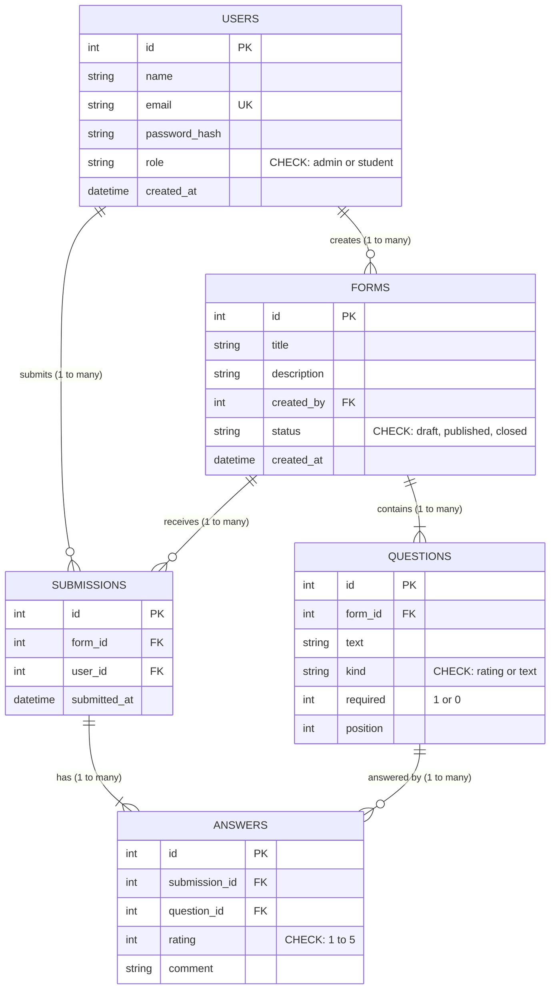

# 📘 FeedbackHub — Complete Beginner & Developer Guide

Welcome to **FeedbackHub**! This guide is written in simple, plain English to help you understand every piece of this project, how the database is structured, how the backend code works, and where every important file is located.

---

## 🔑 1. Quick Admin Credentials

When the project runs (locally or on Render), an **Admin account** and **3 sample published forms** are automatically created for you:

| Field | Value | Notes |
| :--- | :--- | :--- |
| **Login URL** | `/login` (or `https://feedbackhub-dwbj.onrender.com/login`) | Accessible from any browser |
| **Email** | `admin@feedbackhub.com` | Case-insensitive |
| **Password** | `AdminPassword123!` | Secure default password |
| **Role** | `admin` | Gives access to the Admin Dashboard & Analytics |

> [!TIP]
> You can also create your own custom admin at any time using the terminal:
> ```bash
> flask create-admin
> ```
> *(Requires `ADMIN_EMAIL` and `ADMIN_PASSWORD` environment variables).*

---

## 💡 2. What is FeedbackHub? (In Plain Words)

FeedbackHub is an **Online College / Institutional Feedback Management System**. 
Think of it like Google Forms or SurveyMonkey, but specially tailored for colleges and database coursework:

1. **Admins (Faculty / College Staff)**:
   - Log in to create feedback forms with questions.
   - Choose between **1–5 Star Rating** questions and **Written Text** questions.
   - Control the status of forms: `Draft` (working on it), `Published` (students can see and fill it), or `Closed` (no more responses accepted).
   - View visual analytics: interactive rating distribution charts, average score per question, and comments.
   - Export all feedback to a `.csv` spreadsheet file with one click.

2. **Students**:
   - Register for an account with their name, email, and password.
   - See all currently `Published` feedback forms on their dashboard.
   - Fill out forms with interactive 5-star ratings and written suggestions.
   - **Important rule**: Each student can submit each form **only once**. The database prevents duplicate voting.

---

## 📂 3. Project Directory Map (Where Everything Lives)

Here is a map of the repository and what each file does:

```text
dbms mini project/
│
├── app.py                      # 🧠 MAIN BACKEND: Routes, database queries, authentication & business logic
├── requirements.txt            # 📦 Python packages needed (Flask, Flask-WTF, gunicorn)
├── render.yaml                 # 🚀 Render deployment configuration
├── RENDER_DEPLOYMENT.md        # 📝 Notes on hosting on Render cloud
├── GUIDE.md                    # 📖 This complete explanation guide
│
├── instance/
│   └── feedbackhub.sqlite3     # 🗄️ SQLite database file (created automatically on startup)
│
├── static/                     # 🎨 Frontend static assets
│   ├── css/
│   │   └── style.css           # Modern custom styling, variables, animations, star ratings, responsive design
│   └── js/
│       └── app.js              # JavaScript for auto-dismiss alerts, password toggle, dynamic form builder
│
├── templates/                  # 🖼️ HTML pages (Jinja2 templates)
│   ├── base.html               # Master layout (Navbar, flash messages, footer)
│   ├── index.html              # Landing page (hero banner, live stats counter)
│   ├── login.html              # Sign-in page
│   ├── register.html           # Student registration page
│   ├── student_dashboard.html  # Student home (list of available & completed forms)
│   ├── feedback_form.html      # Interactive survey filling page (star rating & comments)
│   ├── admin_dashboard.html    # Admin home (search, filter, form status management)
│   ├── analytics.html          # Visual charts (Chart.js), score breakdown & recent feedback
│   └── error.html              # Custom 403 Forbidden & 404 Not Found error page
│
└── tests/
    └── test_app.py             # 🧪 Automated unit tests (Registration, RBAC permissions)
```

---

## 🗄️ 4. How the Database Works (DBMS Architecture)

The project uses **SQLite 3**, configured in high-performance **WAL (Write-Ahead Logging)** mode with strict **Foreign Key enforcement** (`PRAGMA foreign_keys=ON`).

### The 5 Database Tables:



### Key DBMS Concepts Implemented in this Project:

1. **Foreign Keys with Cascading Deletes (`ON DELETE CASCADE`)**:
   - If an admin deletes a form, all its questions are automatically deleted by the database engine without leaving orphaned records.
   - If a submission is deleted, all corresponding answers are deleted automatically.

2. **Integrity & Check Constraints (`CHECK`)**:
   - `role CHECK(role IN ('admin', 'student'))`: Impossible to insert an invalid user role.
   - `status CHECK(status IN ('draft', 'published', 'closed'))`: Prevents invalid form states.
   - `rating CHECK(rating IS NULL OR rating BETWEEN 1 AND 5)`: Enforces that numeric ratings stay strictly within 1 to 5.

3. **Anti-Duplication Constraint (`UNIQUE(form_id, user_id)`)**:
   - Located on the `submissions` table. Even if a student tries to send multiple requests simultaneously, the database guarantees that a student can only submit once per form.

4. **Performance Indexes**:
   - `idx_forms_status`: Speeds up filtering published forms for students.
   - `idx_submissions_user_form`: Speeds up checking if a student already completed a form (`EXISTS (...)`).
   - `idx_answers_question`: Speeds up analytics queries when grouping answers by question.

5. **SQL Reporting View (`v_question_summary`)**:
   - A pre-defined SQL view that automatically joins `questions`, `forms`, and `answers`, computing `ROUND(AVG(a.rating), 2)` and `COUNT(a.rating)`. Demonstrates relational database abstraction.

---

## 📝 5. The 3 Sample Forms (Included Out-of-the-Box)

The system automatically initializes these 3 published forms in the database:

### Form 1: Course & Instructor Feedback: DBMS (CS301)
- **Target**: Academic course and teaching evaluation.
- **Questions**:
  1. *How clearly did the instructor explain core database concepts (Normalization, ER Modeling, Indexing)?* (1–5 Rating)
  2. *How would you rate the hands-on lab sessions and SQL query practice?* (1–5 Rating)
  3. *Were the textbook references and practice problem sets helpful for your understanding?* (1–5 Rating)
  4. *What topics did you find most challenging, and what can be improved in future lecture sessions?* (Written Text)

### Form 2: Campus Facilities & Computing Infrastructure Survey
- **Target**: Campus resources, Wi-Fi, lab equipment, and library.
- **Questions**:
  1. *How satisfied are you with the computer lab workstations, software availability, and internet speed?* (1–5 Rating)
  2. *How would you rate library resources, study desks, and access to technical journals?* (1–5 Rating)
  3. *Rate the overall hygiene, cleanliness, and maintenance of academic classrooms.* (1–5 Rating)
  4. *What specific equipment or facilities would you like to see upgraded or added on campus?* (Written Text)

### Form 3: Student Experience & Academic Mentorship Feedback
- **Target**: Mentorship, technical clubs, hackathons, and student well-being.
- **Questions**:
  1. *How accessible and supportive were your faculty advisors and mentors when seeking academic help?* (1–5 Rating)
  2. *How would you rate technical workshops, hackathons, and guest speaker seminars held this term?* (1–5 Rating)
  3. *Rate your overall academic growth and satisfaction with student life this semester.* (1–5 Rating)
  4. *What suggestions or ideas do you have to make student mentorship and campus life even better?* (Written Text)

---

## 🔍 6. How the Code Works (Important Files & Functions)

### A. Backend Core (`app.py`)

- **`get_db()`** *(Lines 21–28)*:
  Opens a connection to the SQLite database per web request and attaches it to Flask's `g` context object. Sets WAL mode and foreign keys.
- **`close_db()`** *(Lines 32–37)*:
  Automatically closes the SQLite connection when the web request finishes.
- **`init_db()` & `seed_initial_data()`** *(Lines 40–183)*:
  Creates the database schema if tables don't exist and automatically inserts the Admin account and 3 sample forms.
- **`login_required` & `role_required`** *(Lines 185–204)*:
  Security decorators. If an unauthenticated user tries to visit an admin page, they are blocked with a `403 Forbidden` error.
- **`feedback_form(form_id)`** *(Lines 267–333)*:
  Handles the student survey submission. It reads the answers, verifies required fields, and performs an atomic database transaction (`with db:`):
  - Inserts one row into `submissions`
  - Inserts each answer into `answers` via `db.executemany(...)`
- **`analytics()`** *(Lines 387–432)*:
  Queries the database for:
  - Average ratings per question using SQL `AVG(rating)`.
  - Distribution breakdown (counting how many 1★, 2★, 3★, 4★, and 5★ votes exist).
  - The 30 most recent written comments.
- **`export_csv()`** *(Lines 434–449)*:
  Generates a dynamic CSV file directly from the database and streams it to the user's browser as a file download (`feedbackhub-responses.csv`).

### B. Frontend Templates (`templates/`)

- **`base.html`**:
  The parent template. Contains the navigation bar, flash notification container (e.g. "Account created successfully"), and footer. All other pages extend this.
- **`feedback_form.html`**:
  The student survey page. Features:
  - Interactive Star Rating selector (★ 1 to ★ 5) with hover animation.
  - Live feedback text below stars (e.g., *"Selected: 5 out of 5 (Excellent)"*).
  - Character counter on written response text boxes (`0 / 2000 characters`).
- **`admin_dashboard.html`**:
  The admin control center. Features:
  - KPI Stat cards (Total Students, Forms, Submissions, Average Rating).
  - Interactive Filter Tabs: *All forms*, *Published*, *Drafts*, *Closed*.
  - Real-time search box to quickly find forms by title.
  - Dropdown to switch status between `draft`, `published`, and `closed`.
- **`analytics.html`**:
  The data visualization hub. Powered by **Chart.js** (loaded via CDN) to render a clean bar chart of the star rating distribution and progress bars for question averages.

---

## 🚀 7. Running the Project

### Running Locally on Your Computer

1. **Open PowerShell / Terminal** in the project folder:
   ```powershell
   cd "C:\Users\Ravish\Downloads\dbms mini project"
   ```

2. **Install requirements** (if not already installed):
   ```powershell
   pip install -r requirements.txt
   ```

3. **Run automated unit tests** (verifies database & permissions):
   ```powershell
   python -m unittest tests/test_app.py
   ```
   *(You should see `Ran 2 tests ... OK`)*

4. **Start the application**:
   ```powershell
   $env:FLASK_DEBUG="1"
   python app.py
   ```

5. **Open in browser**:
   - Go to: [http://127.0.0.1:5000](http://127.0.0.1:5000)
   - Admin Login: [http://127.0.0.1:5000/login](http://127.0.0.1:5000/login)

---

### Running on Render (Cloud Deployment)

Since your project is linked to GitHub repository [`https://github.com/akshatambasta-dev/DBMS-mini-project-`](https://github.com/akshatambasta-dev/DBMS-mini-project-):

1. Whenever you commit and push to `main`, Render automatically triggers a new build and deploys your changes.
2. The live site URL: [https://feedbackhub-dwbj.onrender.com](https://feedbackhub-dwbj.onrender.com)
3. Because we added `seed_initial_data()` directly inside `init_db()`, the live site will automatically have:
   - Admin Email: `admin@feedbackhub.com`
   - Admin Password: `AdminPassword123!`
   - The 3 published sample forms ready to be filled out!
